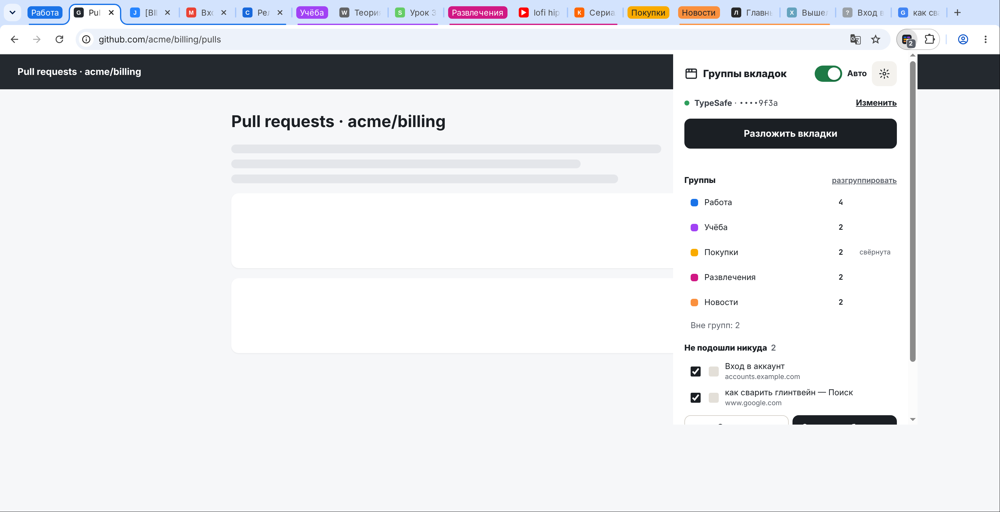
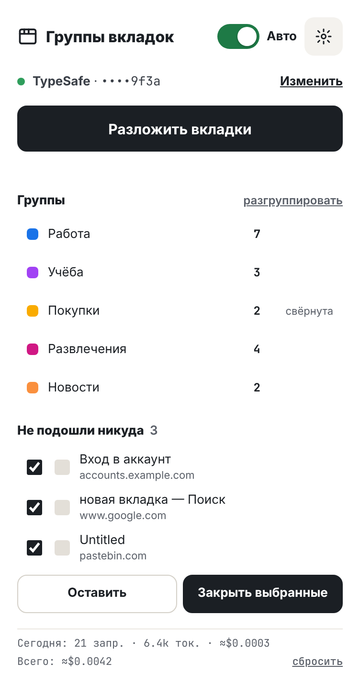
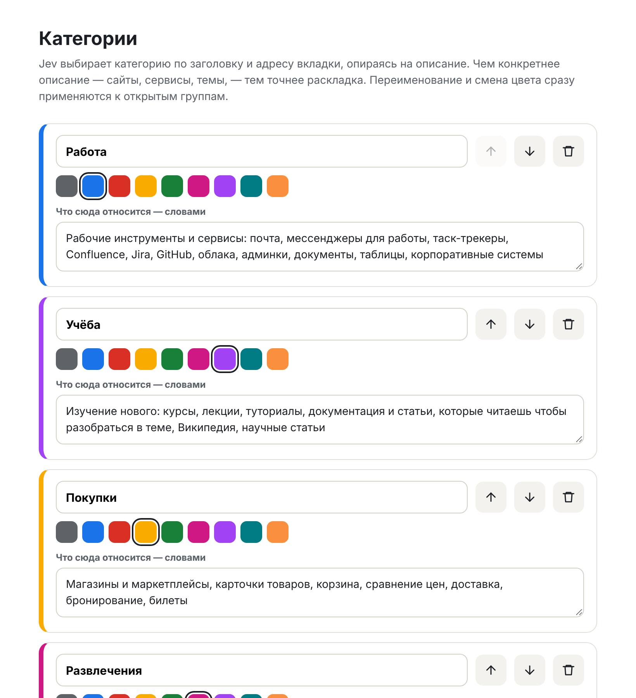
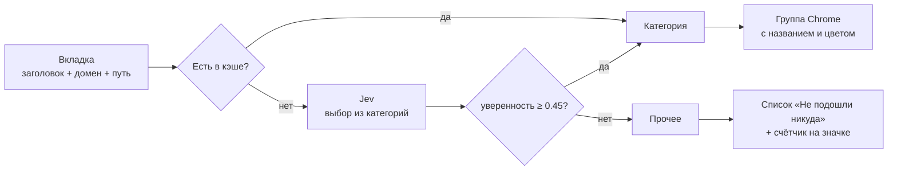

<div align="center">


# Умные группы вкладок

**Расширение для Chrome, которое само раскладывает вкладки по цветным группам<br>и подсказывает, какие из них можно закрыть.**

Работа · Учёба · Покупки · Развлечения · Новости — или любые свои категории.<br>
Решение по каждой вкладке принимает модель **Jev** по заголовку и адресу страницы.

<sub>🧩 Один из примеров применения моделей Jev: <a href="#-при-чём-тут-jev">как это устроено</a></sub>


[Возможности](#-возможности) ·
[Установка](#-установка) ·
[При чём тут Jev](#-при-чём-тут-jev) ·
[Как это работает](#-как-это-работает) ·
[Настройка категорий](#-настройка-категорий) ·
[Провайдеры](#-провайдеры-jev) ·
[Приватность](#-приватность) ·
[FAQ](#-faq)

</div>

---

<p align="center">
  
  <br><sub>Так это выглядит в Chrome: вкладки разложены по группам, в попапе — сводка и две вкладки, которые никуда не подошли</sub>
</p>

### До и после одного клика

**До** — 14 вкладок вперемешку:


**После** — цветные группы «Работа», «Учёба», «Развлечения», «Покупки» (свёрнута) и «Новости»; вход в аккаунт и поисковый запрос остались вне групп:


### Попап и настройки

<table>
<tr>
<td width="38%" valign="top"></td>
<td valign="top"></td>
</tr>
<tr>
<td align="center"><sub>Попап: группы, «лишние» вкладки и расход</sub></td>
<td align="center"><sub>Настройки: свои категории, цвета и описания</sub></td>
</tr>
</table>

## ✨ Возможности

| | |
|---|---|
| 🗂 **Раскладка в один клик** | Кнопка «Разложить вкладки» отправляет все свободные вкладки окна в Jev и кладёт каждую в группу своей категории. Нужной группы нет — она создаётся с правильным названием и цветом. |
| ⚡ **Авто-режим** | Новая вкладка после загрузки сама встаёт в свою группу. Вкладки, открытые из ссылки внутри группы, Chrome и так оставляет в ней — расширение их не трогает. |
| 🧹 **«Не подошли никуда»** | Всё, что не попало ни в одну категорию (или где Jev не уверен), не группируется, а попадает в список с галочками и кнопкой «Закрыть выбранные». Число таких вкладок видно на значке. |
| 🎨 **Свои категории** | До 10 категорий: название, один из 9 цветов групп Chrome и описание словами — именно по нему Jev и решает. Переименование и смена цвета сразу применяются к открытым группам. |
| 👀 **Обзор групп** | В попапе — цвет, название и число вкладок в каждой группе. Клик сворачивает или разворачивает группу, «разгруппировать» снимает все группы категорий. |
| 💾 **Память решений** | Ответы кэшируются по домену и заголовку, поэтому повторная раскладка бесплатна. Поменяли описания категорий — кэш сбрасывается сам. |
| 💸 **Счётчик расхода** | Запросы, токены и деньги за сегодня и за всё время, плюс остаток на балансе для OpenRouter. |
| 🔌 **Пять провайдеров** | TypeSafe, OpenRouter, NanoGPT, DigitalOcean или собственный адрес (LiteLLM, Kong и т. п.). Провайдер угадывается по формату ключа. |

## 🚀 Установка

Расширение пока не опубликовано в Chrome Web Store, поэтому ставится как распакованное:

1. Скачайте репозиторий — `git clone https://github.com/fatalbazuka/jev-tabs.git` или **Code → Download ZIP** — либо готовый архив со страницы [Releases](../../releases).
2. Откройте `chrome://extensions` и включите **«Режим разработчика»** (переключатель справа вверху).
3. Нажмите **«Загрузить распакованное»** и выберите папку **`extension`**.
4. Закрепите значок расширения на панели, откройте попап.
5. Выберите провайдера, вставьте API-ключ и нажмите **«Проверить и сохранить»** — расширение сделает тестовый запрос и покажет, подошёл ли ключ.

> [!TIP]
> Кнопка «Вставить из буфера» сама определит провайдера по префиксу ключа: `sk-or-…` → OpenRouter, `ts-…` → TypeSafe, `sk-do-…` / `dop_v1_…` → DigitalOcean.

Работает в Chrome и других браузерах на Chromium с поддержкой групп вкладок (Edge, Brave, Opera, Яндекс Браузер и др.).

## 🧩 При чём тут Jev

Это расширение — **одно из применений моделей Jev**, пример того, как их можно встроить в обычный повседневный инструмент.

Jev здесь не пишет текст и не ведёт диалог: он **принимает решение**. Расширение передаёт ему небольшое описание ситуации (заголовок, домен и путь вкладки) и вопрос с вариантами ответа — категориями, описанными обычными словами. Jev выбирает один вариант и сообщает, насколько уверен. Всё остальное — группы, цвета, список «лишних» вкладок — делает уже само расширение.

```text
ситуация  →  { title, domain, path }
вопрос    →  «к какой категории относится вкладка?»
варианты  →  Работа: …, Учёба: …, Покупки: …, Развлечения: …, Новости: …, other: …
ответ     ←  { choice: "work", confidence: 0.92 }
```

Тот же приём подходит для многих других задач, где нужно выбрать один из вариантов по описанию: разбирать почту и обращения в поддержку, раскладывать файлы и заметки, помечать задачи и т. п. Если хотите сделать что-то похожее, формат запроса описан в [docs/ARCHITECTURE.md](docs/ARCHITECTURE.md#запрос-к-jev).

## 🧠 Как это работает



1. **Что уходит в модель.** Только заголовок страницы (до 200 символов), домен и путь с параметрами (до 120 символов). Содержимое страницы Jev не видит.
2. **Вопрос.** Jev получает список категорий в формате `название: описание` плюс служебную категорию `other` и выбирает одну — главную, если подходит несколько.
3. **Порог уверенности.** Если Jev сомневается (`confidence < 0.45`), вкладка считается «прочей», чтобы не засорять группы.
4. **Группировка.** Все изменения групп выполняются строго по очереди — две параллельные вкладки не создадут две «Работы».
5. **Что раскладывается.** Только незакреплённые `http(s)`-вкладки, которые ещё не лежат в группе. Ваши собственные группы и закреплённые вкладки не трогаются.
6. **Пакетная обработка.** При ручной раскладке вкладки идут в Jev по 4 одновременно; при ошибке ключа (401/403) раскладка останавливается сразу.

Подробности устройства — в [docs/ARCHITECTURE.md](docs/ARCHITECTURE.md).

## 🎨 Настройка категорий

Страница настроек открывается шестерёнкой в попапе или через «Параметры расширения».

- Для каждой категории задаются **название** (до 24 символов), **цвет** из 9 цветов групп Chrome и **описание словами** — оно уходит в Jev как критерий выбора.
- Категории можно **добавлять** (до 10), **удалять**, **менять порядок** и **возвращать набор по умолчанию**.
- Категория **«Прочее»** есть всегда и не редактируется.
- Кнопка «Сбросить память сейчас» очищает кэш решений вручную.

> [!TIP]
> Перечисляйте в описании конкретные сайты и сервисы, а не общие слова. Например: *«Confluence банка, Jira, СМЭВ, корпоративная почта»* или *«BotFather, документация aiogram, мой сервер, GitHub-репозиторий бота»*. Jev смотрит только на заголовок и адрес — чем больше узнаваемых доменов, тем точнее раскладка.

<details>
<summary><b>Категории по умолчанию</b></summary>

| Категория | Цвет | Что относится |
|---|---|---|
| Работа | 🔵 синий | Почта, мессенджеры для работы, таск-трекеры, Confluence, Jira, GitHub, облака, админки, документы, таблицы, корпоративные системы |
| Учёба | 🟣 фиолетовый | Курсы, лекции, туториалы, документация и статьи «чтобы разобраться», Википедия, научные статьи |
| Покупки | 🟡 жёлтый | Магазины и маркетплейсы, карточки товаров, корзина, сравнение цен, доставка, бронирование, билеты |
| Развлечения | 🩷 розовый | Видео, сериалы, фильмы, музыка, игры, стримы, соцсети и ленты, мемы |
| Новости | 🟠 оранжевый | Новостные сайты и ленты, свежие события, обзоры происходящего |
| *Прочее* | — | Пустые и служебные страницы, страницы входа, результаты поиска, разовые ссылки — **не группируются** |

</details>

## 🔌 Провайдеры Jev

| Провайдер | Модель | Где взять ключ |
|---|---|---|
| **TypeSafe** | `jev-latest` | [console.typesafe.ai → Keys](https://console.typesafe.ai/keys) |
| **OpenRouter** | `~typesafe/jev-latest` | [openrouter.ai → Settings → Keys](https://openrouter.ai/settings/keys) |
| **NanoGPT** | `typesafe/jev-latest` | [nano-gpt.com → API](https://nano-gpt.com/api) |
| **DigitalOcean** | `typesafe-jev-1.13.0` | DigitalOcean → Serverless Inference → Model access keys |
| **Свой адрес** | любая | Любой сервис или прокси с API Jev. Адрес должен начинаться с `https://`; доступ к хосту расширение запросит отдельно. |

### Счётчик расхода

Внизу попапа видно число запросов, токенов и стоимость за сегодня и за всё время, а для OpenRouter — ещё и остаток баланса. Если провайдер не вернул стоимость, она считается по цене TypeSafe (**$0.042 за 1M входных токенов**, выход бесплатный) и помечается знаком **≈**. Счётчик можно сбросить ссылкой «сбросить».

## 🔒 Приватность

- **Нет своего сервера.** Расширение общается только с выбранным вами провайдером Jev.
- **Минимум данных.** В модель уходят только заголовок, домен и путь вкладки — без содержимого страниц, cookies и истории.
- **Ключ хранится в браузере** — в `chrome.storage.sync` и уходит только в заголовке `Authorization` к провайдеру.
- **Кэш решений** (до 3000 записей) и счётчик расхода лежат локально в `chrome.storage.local`.

Подробно — в [PRIVACY.md](PRIVACY.md).

<details>
<summary><b>Зачем расширению каждое разрешение</b></summary>

| Разрешение | Для чего |
|---|---|
| `tabs` | Читать заголовки и адреса вкладок, закрывать выбранные «лишние» вкладки |
| `tabGroups` | Создавать, переименовывать, перекрашивать и сворачивать группы |
| `storage` | Хранить настройки, ключ, кэш решений и счётчик расхода |
| `clipboardRead` | Кнопка «Вставить из буфера» для ключа |
| Доступ к хостам провайдеров | Запросы к API Jev |
| `https://*/*` *(опционально)* | Запрашивается, только если вы указали «Свой адрес», и только для этого хоста |

</details>

## ❓ FAQ

<details>
<summary><b>Вкладка попала не в ту группу</b></summary>

Уточните описание категории: добавьте домены и названия сервисов, которые должны в неё попадать. После сохранения кэш сбросится, и следующая раскладка учтёт новые описания.
</details>

<details>
<summary><b>Почему часть вкладок не группируется?</b></summary>

Не раскладываются закреплённые вкладки, вкладки, уже лежащие в любой группе, и служебные страницы (`chrome://`, `file://` и т. п.). Вкладки, в которых Jev не уверен, попадают в список «Не подошли никуда».
</details>

<details>
<summary><b>Не трогает ли расширение мои собственные группы?</b></summary>

Нет. Расширение работает только с группами, чьё название совпадает с названием одной из категорий. Если вы удалили категорию, её группа остаётся как обычная пользовательская.
</details>

<details>
<summary><b>Сколько это стоит?</b></summary>

Одна вкладка — один короткий запрос. Благодаря кэшу повторная раскладка тех же страниц бесплатна. Точные цифры видны в счётчике внизу попапа.
</details>

<details>
<summary><b>Как повторить демо с нуля?</b></summary>

Нажмите «разгруппировать» в попапе — группы категорий снимутся, и можно снова нажать «Разложить вкладки».
</details>

## 🗂 Структура репозитория

```
jev-tabs/
├── extension/              ← эту папку загружать в Chrome
│   ├── manifest.json       манифест MV3
│   ├── background.js       service worker: Jev, кэш, группы, авто-режим, сообщения
│   ├── popup.html/.js      попап: ключ, раскладка, группы, «лишние», расход
│   ├── options.html/.js    страница категорий
│   ├── colors.js           палитра цветов групп Chrome
│   └── icons/              иконки (SVG-исходник и PNG 16–128)
├── docs/
│   ├── ARCHITECTURE.md     устройство расширения
│   ├── screenshots.js      съёмка скриншотов для README
│   └── images/             скриншоты
├── .github/                шаблоны issue и сборка релиза
├── CHANGELOG.md
├── CONTRIBUTING.md
├── PRIVACY.md
└── LICENSE
```

## 🤝 Участие

Идеи и баг-репорты — в [Issues](../../issues). Как устроен проект и как присылать изменения — в [CONTRIBUTING.md](CONTRIBUTING.md).

## 📄 Лицензия

[MIT](LICENSE)
