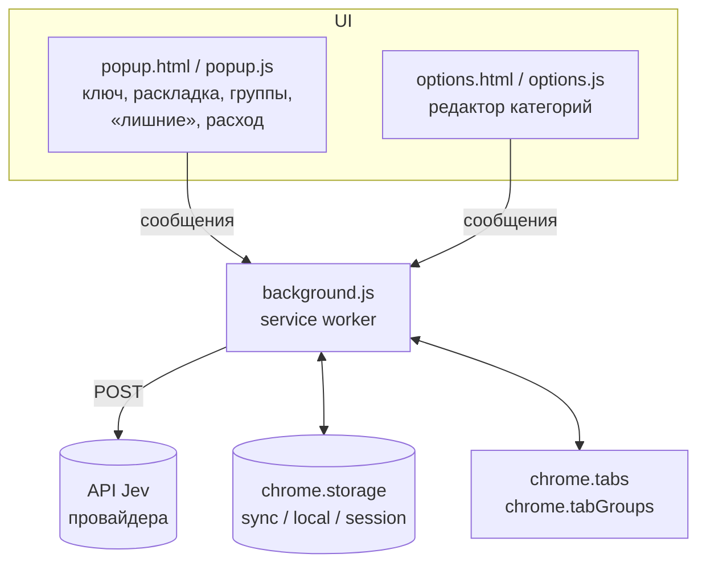

# Устройство расширения

Расширение написано на чистом JavaScript под Manifest V3, без сборки и зависимостей. Оно состоит из трёх частей, которые общаются сообщениями `chrome.runtime.sendMessage`.



## Файлы

| Файл | Роль |
|---|---|
| `manifest.json` | Разрешения, хосты провайдеров, попап и страница настроек |
| `background.js` | Вся логика: настройки, запросы к Jev, кэш, работа с группами, авто-режим, учёт расхода, обработчик сообщений |
| `popup.html` / `popup.js` | Интерфейс попапа |
| `options.html` / `options.js` | Редактор категорий |
| `colors.js` | Соответствие 9 цветов групп Chrome их HEX-значениям и русским названиям |

## Хранилища

| Где | Ключи | Что лежит |
|---|---|---|
| `storage.sync` | `apiKey`, `provider`, `endpoint`, `model`, `auto`, `categories` | Настройки, синхронизируются между устройствами пользователя |
| `storage.local` | `t:<подпись категорий>:<хэш>` | Кэш решений: `{ cat, t }`, не больше 3000 записей, старые вытесняются |
| `storage.local` | `usage` | Счётчик расхода: `{ day, total }` |
| `storage.session` | `leftovers`, `pending` | Вкладки «Не подошли никуда» и вкладки, ждущие загрузки для авто-режима; живут до перезапуска браузера |

## Запрос к Jev

```json
POST <endpoint>
Authorization: Bearer <apiKey>

{
  "model": "jev-latest",
  "state": { "title": "…", "domain": "github.com", "path": "/org/repo/pulls" },
  "questions": {
    "group": {
      "type": "choice",
      "instructions": "Это одна открытая вкладка браузера… Если не уверен — other.",
      "criteria": {
        "work":  "Работа: Рабочие инструменты и сервисы…",
        "study": "Учёба: Изучение нового…",
        "other": "Не подходит ни под одну категорию выше…"
      }
    }
  }
}
```

Ответ: `answers.group.choice` — id категории и `answers.group.confidence`. Если уверенность ниже `0.45`, вкладка считается «прочей». Из `usage` берутся токены (`input_tokens` / `prompt_tokens` / `total_tokens`) и стоимость (`cost`); если стоимости нет, она оценивается по цене TypeSafe. Таймаут запроса — 10 секунд.

## Кэш

Ключ кэша состоит из подписи набора категорий (хэш djb2 от всех `id:desc`) и хэша `домен|заголовок`. Поэтому изменение любого описания автоматически делает старые решения недействительными, а смена только названия или цвета кэш не сбрасывает.

## Сценарии

### «Разложить вкладки»
1. Берутся вкладки текущего окна: незакреплённые, `http(s)`, вне групп.
2. Классифицируются пачками по 4. При 401/403 цикл прерывается.
3. Под общей блокировкой `serial()` для каждой категории проверяется, что вкладки ещё открыты, и они кладутся в существующую группу с таким названием или в новую.
4. «Прочие» добавляются в `leftovers`, на значке обновляется счётчик.

### Авто-режим
`tabs.onCreated` запоминает id новой вкладки в `pending`. Когда `tabs.onUpdated` сообщает `status: complete`, вкладка классифицируется и, если она всё ещё свободна, кладётся в группу. Ошибки здесь проглатываются, чтобы авто-режим не мешал работе.

### Изменение категорий
`saveCategories` сохраняет новый список и вызывает `syncGroups`: открытые группы ищутся по старому названию и получают новое название и цвет. Группы удалённых категорий не трогаются.

## Сообщения background.js

| `type` | Что делает |
|---|---|
| `settings`, `defaults`, `providers` | Отдают настройки, набор по умолчанию и список провайдеров |
| `sort` | Раскладывает окно `windowId` |
| `ungroup` | Снимает группы категорий в окне |
| `summary` | Сводка: категории, число вкладок, состояние групп |
| `toggleGroup` | Сворачивает или разворачивает группу |
| `leftovers`, `closeTabs`, `keepTabs` | Список «прочих» вкладок и действия с ним |
| `saveCategories` | Сохраняет категории и обновляет открытые группы |
| `testKey` | Тестовый запрос с новым ключом |
| `getUsage`, `resetUsage`, `getBalance` | Счётчик расхода и баланс OpenRouter |
| `clearCache` | Очищает кэш решений |
